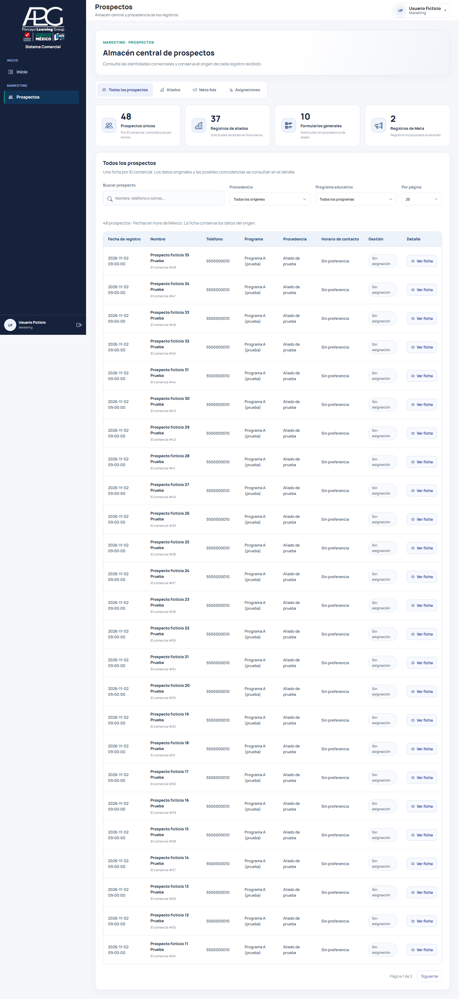
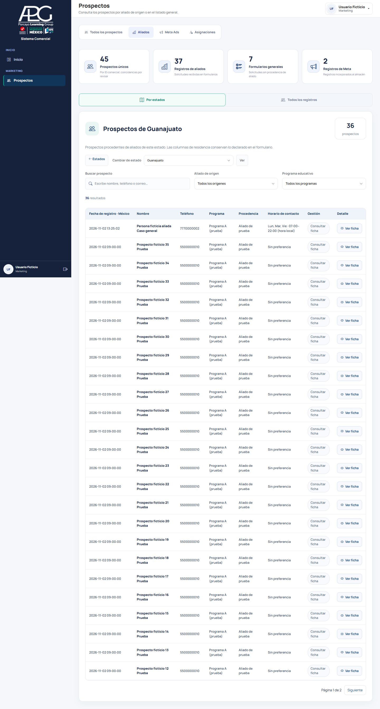
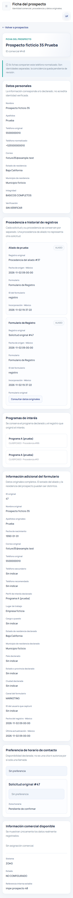

# Prospectos: almacén central, Fase 1

## Alcance y base comprobada

La rama parte de `feat/registro-horario-contacto`, commit `31049506880ecca15c495e03b3d57a8d8dc5f63d`. Conserva tarjetas, mapas, búsqueda automática, filtros y preferencias de horario. Se incorporó también la presentación de fechas de `fix/prospectos-fecha-registro-mexico`.

La versión real de Hostinger se reconstruyó con los hashes y comparaciones proporcionados por el propietario. Se verificaron las variantes de `FormularioRegistroModel`, `FormularioAliadoService`, `FormularioPublicoController` y la tipografía V3 de Prospectos. Las dependencias internacionales, catálogo de programas y conexión coinciden con los tres hashes recibidos el 2 de noviembre de 2026. No se ha accedido a producción ni ejecutado un despliegue o SQL de escritura.

El PR incluye estas conciliaciones de código respecto a su rama base. El publicador **sólo cambia cuatro archivos existentes**: controlador de Prospectos, modelo de Prospectos, modelo de Registro y vista de Prospectos. Las vistas públicas y su validación cliente de la rama incluyen el campo CSRF y los tres campos internacionales que requiere el controlador de producción reconstruido, conservando la preferencia de horario; este ajuste de coherencia de la rama tampoco se publica sobre las vistas personalizadas de Hostinger. Los servicios originales de aliados, controladores de formularios, ubicación, catálogo, conexión y horario se verifican como dependencias; no se reemplazan en Hostinger.

El archivo Meta aportado se examinó únicamente para reconocer su estructura: TSV con BOM UTF-16, 1,271 filas, identificadores de lead, anuncio, conjunto, campaña y formulario. No se importó ni se copiaron datos personales a fixtures, capturas o commits. No se infiere programa educativo del nombre del archivo o del formulario.

## Modelo de datos

| Tabla nueva | Función |
| --- | --- |
| `prospectos_comerciales` | Identidad comercial estable; datos mínimos opcionales, integridad y verificación. Teléfono no único. |
| `prospecto_origenes` | Solicitudes originales y procedencias independientes, IDs externos textuales, fecha/zona originales, lote futuro. |
| `prospecto_intereses` | Programa explícito y procedencia que lo originó. Catálogo existente cuando hay coincidencia exacta y única. |
| `prospecto_preferencias_contacto` | Valor original exacto y estructura conservadora de días/horas. Zona desconocida permanece pendiente. |
| `prospecto_asignaciones` | Historial preparatorio de responsable, asignación, trabajo y próxima acción. Sin distribución automática. |
| `prospecto_integraciones` | Referencia interna estable y estado externo futuro. Zoho permanece `NO_CONFIGURADO`. |

Una solicitud de `formulario_registros` constituye un evento raíz (`IMPE_FORMULARIOS/REGISTRO/ID`). Cada procedencia de `formulario_aliado_procedencias` constituye un evento hijo de esa solicitud. La relación compuesta impide enlazar un hijo o un interés con otra identidad. Los hijos no suman otra solicitud en los indicadores. La combinación sistema/tipo/identificador es única; los IDs externos usan texto y colación binaria.

La conciliación crea una identidad por solicitud original. No afirma que distintas solicitudes pertenezcan a distintas personas físicas: las coincidencias por teléfono se señalan en la ficha y no se fusionan. El indicador “Prospectos únicos” cuenta **IDs comerciales**, con esta aclaración visible. Una identidad admite varias procedencias e intereses cuando existe un vínculo explícito. No hay proceso de vinculación por similitud.

Los indicadores de aliados y formularios generales cuentan solicitudes originales recibidas, incluso si su incorporación comercial está pendiente. El indicador de Meta cuenta eventos raíz de Meta, no personas. Los valores no verificables se muestran como “—”, no cero.

## Guardado y recuperación

El formulario conserva su validación, autorización de programa, ubicación internacional, deduplicación y transacción originales. Después de obtener su ID confirmado, Registro intenta incorporarlo mediante una **conexión independiente**. La conciliación bloquea la fila original durante su transacción comercial para serializar dos incorporaciones simultáneas, pero nunca cambia esa fila. La identidad conserva su primera captura; las futuras correcciones o fusiones de identidad requieren una operación explícita. Las solicitudes fallidas en el componente comercial permanecen guardadas y pueden recuperarse por CLI. Los errores nuevos sólo registran clase/código, sin SQL ni valores personales.

La incorporación preserva el horario recibido y no cambia la fecha de incorporación al repetir un lote. Los eventos originales mantienen su ID y referencia; no se eliminan formularios, inscripciones, procedencias, catálogos, aliados ni convocatorias. Inscripción continúa fuera de la incorporación de Registro. La lista territorial continúa usando el estado **del aliado** y la ficha presenta la residencia **del prospecto** por separado.

La migración sólo crea seis tablas. Comprueba tipos, nulabilidad, índices, colaciones de identificadores y columnas de relaciones antes de aceptar una estructura existente. El DDL de MariaDB puede confirmar implícitamente: una creación parcialmente completada se reanuda de forma idempotente; no se promete revertir DDL mediante `ROLLBACK`. Véanse [CREATE TABLE](https://mariadb.com/docs/server/server-usage/tables/create-table), [confirmaciones implícitas](https://mariadb.com/docs/server/reference/sql-statements/transactions/sql-statements-that-cause-an-implicit-commit) y [FOR UPDATE](https://mariadb.com/docs/server/reference/sql-statements/data-manipulation/selecting-data/for-update).

## Consulta

- **Todos los prospectos:** identidades del almacén, filtros automáticos y páginas de 25/50/100 registros.
- **Aliados:** navegación territorial original, sus 32 tarjetas/mapas, buscadores, filtros combinados y listado de todos los registros originales, incluidos generales.
- **Meta Ads:** consulta de procedencias existentes; no hay botón de importación.
- **Asignaciones:** historial real o estado vacío. No asigna ni inventa responsables.
- **Ficha:** personales, originales del formulario, origen histórico, intereses, preferencia exacta, coincidencias y datos comerciales disponibles. Los historiales de orígenes e intereses tienen paginación de 25. La ficha muestra las últimas 25 asignaciones.

La tabla se reduce de 15 a 8 columnas y conserva los demás datos en la ficha. Los enlaces antiguos con `vista`, `estado_id` o filtros de la lista continúan abriendo Aliados. Un registro original todavía no conciliado tiene su ficha de consulta sin insertar datos mediante GET.

Las fechas UTC confirmadas se presentan en México; no se resta una cantidad fija a fechas cuyo origen no tiene zona confirmada. La disponibilidad “hora local” no se transforma en cita. La consulta exige `prospectos.ver_todos` en el servidor. La Fase 1 deniega el acceso comercial a roles Asesor (ID 3), incluso si reciben por error ese permiso global; su acceso por asignación se implementará después. No se otorgan permisos a otros roles.

## Publicación preparada, pendiente de autorización

Archivos operativos:

- `tools/publicar_prospectos_central.py`: publicación selectiva sin SQL, respaldo privado y restauración.
- `tools/prospectos_central_release.json`: contenido y hashes reales; bloquea cualquier variante desconocida antes de escribir.
- `tools/prospectos_almacen.php`: migración y conciliación explícitas, sólo CLI.

No hacer `git pull` en `public_html`. No ejecutar los pasos `--apply` sin la autorización posterior solicitada para producción. Obtener un respaldo habitual de la base desde la administración del hosting antes de la migración. El publicador respalda archivos, no sustituye un respaldo SQL.

Ejemplo de secuencia **para una instalación autorizada**, con los dos archivos de publicación obtenidos del mismo commit del PR:

```bash
SITIO="$HOME/domains/fundacionrededumex.org/public_html"
RESPALDOS="$HOME/respaldos-impe-prospectos-central"
python3 publicar_prospectos_central.py --site "$SITIO" --backup-root "$RESPALDOS" --check
# Sólo después de revisar compatibilidad y autorizar la instalación:
python3 publicar_prospectos_central.py --site "$SITIO" --backup-root "$RESPALDOS" --apply

# El código nuevo no ejecuta DDL desde solicitudes web.
php "$SITIO/tools/prospectos_almacen.php" --site "$SITIO" --check
php "$SITIO/tools/prospectos_almacen.php" --site "$SITIO" --check --reconciliar --limite 100
# Sólo con autorización SQL:
php "$SITIO/tools/prospectos_almacen.php" --site "$SITIO" --apply --migrar
php "$SITIO/tools/prospectos_almacen.php" --site "$SITIO" --check --reconciliar --limite 100
php "$SITIO/tools/prospectos_almacen.php" --site "$SITIO" --apply --reconciliar --desde-id 0 --limite 100
php "$SITIO/tools/prospectos_almacen.php" --site "$SITIO" --check --integridad
```

Cada lote entrega `continuar_desde`, `hasta_id`, `terminado` y errores sin datos personales. Reutilizar el `hasta_id` del primer lote para un corte estable y continuar desde el cursor devuelto. Si hay fallas, el cursor vuelve al primer ID fallido menos uno y `terminado` es falso; los registros ya incorporados se reconocen al reintentar. Nuevos formularios que lleguen después del corte se incorporan por el hook o por otro lote.

La integridad debe mostrar cero referencias originales ausentes y, al terminar los lotes de recuperación, cero solicitudes/procedencias pendientes. Los teléfonos coincidentes **no son un error de integridad** ni se fusionan. Los conteos del `--check` son una previsualización; pueden variar si llegan formularios mientras se consulta.

Para revertir sólo el código:

```bash
python3 publicar_prospectos_central.py --site "$SITIO" --restore "/ruta/real/del/respaldo-generado"
```

La restauración comprueba que nadie haya cambiado los archivos después de publicar. Conserva las seis tablas y cualquier registro comercial creado. No se proporciona `DROP TABLE` de reversión. Si se restaura el modelo original, las nuevas solicitudes siguen guardándose en formularios y se recuperan comercialmente cuando se reinstale esta fase y se concilie.

## Validación

Fixtures ficticios en bases aisladas con prefijo obligatorio; nunca se usan credenciales ni registros de producción.

```bash
python3 tests/prospectos_central_db.py
php tests/horario_contacto_unit.php
python3 tests/publicacion_prospectos_central_test.py
# Requiere APP_ENV=testing, IMPE_DB_* de una BD aislada, PHP_BINARY,
# Playwright y las dependencias Bootstrap/Manrope en IMPE_BROWSER_DEPS.
node tests/prospectos_central_browser.cjs
```

La suite SQL prueba ausencia de escrituras en `--check`, migración repetida, originales intactos, recuperación de fallas, concurrencia, IDs externos largos con ceros iniciales, programas explícitos, varios orígenes, horarios nulos/vacíos/sin preferencia/personalizados, teléfono compartido, Inscripción, internacional por convocatoria, deduplicación y relaciones/colaciones incompatibles.

La suite de navegador utiliza controladores y layout reales: 8 columnas, paginación y búsqueda automática, los 32 estados, filtros de aliado/programa, ficha, fechas, escape HTML, escritorio/móvil, permiso de Marketing/Admin y rechazo de Asesor/sin permiso. Comprueba que toda la navegación GET no cambie la base. Incluye POST a controladores originales de Registro público/interno/aliado e Inscripción con su protección CSRF existente. El publicador se prueba sobre copias: versiones desconocidas, dependencias cambiadas, idempotencia, restauración y bloqueo de cambios posteriores.

Capturas con datos ficticios:





La validación local usa PHP 8.2, MariaDB 10.4 y Chrome. El workflow específico pasó en GitHub con MariaDB 10.11 y 11.8 en el primer commit del PR. La regresión visual territorial actualizada pasó 92 comprobaciones (incluyendo cinco tamaños, mapas, respuestas fuera de orden, filtros y navegación sin JavaScript). La regresión SQL de horario pasó 13 comprobaciones con el esquema internacional conciliado, además de sus 21 comprobaciones unitarias y 58 de navegador con envíos reales por Registro público, interno y liga anterior. Las suites SQL territoriales previas pasaron 36 y 35 comprobaciones de consultas y filtros. La regresión Handly también pasó en modelo y navegador, incluyendo Registro, Inscripción, rechazo de programas y reenvíos. La comprobación final del esquema y los datos reales permanece pendiente de una instalación autorizada. No se afirma haber probado llamadas, campañas reales o sincronizaciones externas: esta fase no modifica sus motores ni sus archivos.

## Límites de esta entrega

No hay importación operativa Meta, carga del archivo entregado, reparto de 80 registros, asignación automática, configuración de jornadas/programas por asesor, nuevas llamadas desde la ficha ni peticiones a Zoho. La asignación se reserva en una tabla, el lote futuro como referencia del origen y Zoho como identificador/estado inactivo; no se crean procesos aparentes. No se cambian telefonía, grabaciones, notificaciones, transferencias, QR ni enlaces existentes.

## Comprobaciones heredadas del repositorio

El PR se mantiene en borrador mientras se concilian los resultados de los workflows históricos. Las pruebas territoriales antiguas se actualizaron para consultar explícitamente Aliados y comprobar ocho columnas, dejando los datos adicionales en la ficha. La fixture de Horario se adaptó a las columnas internacionales que ya exige el modelo instalado, sin cambiar el esquema real.

Hay también fallos de telefonía en la rama base: `php tests/telefonia_shell_smoke.php` reproduce “Auto recepción configurable para el usuario” y los archivos de esa prueba y de su motor no tienen diferencias respecto a `31049506`. No se corrigen motores de llamadas dentro de esta fase ni se presenta el conjunto completo de CI como aprobado. La publicación selectiva no contiene ninguno de esos archivos.
